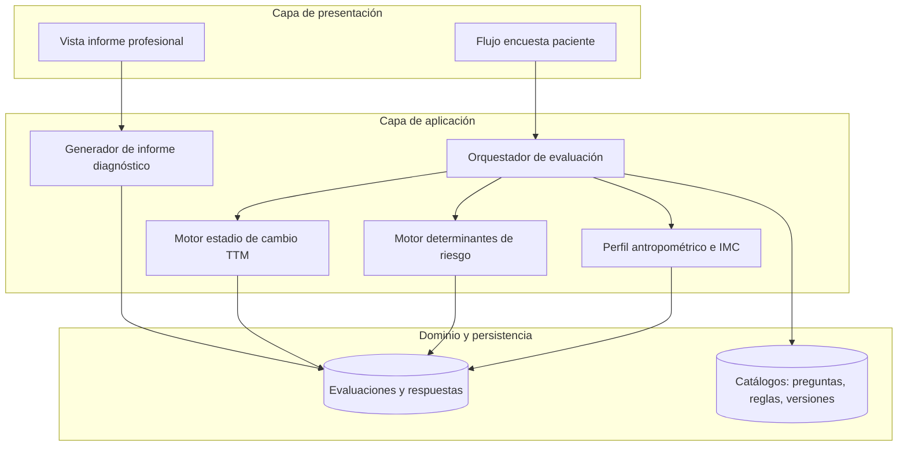

# Evaluación clínica de estilo de vida y estadio de cambio

Documento de arquitectura y mesa de trabajo para el inicio del proyecto.  
**Contexto:** digitalización de encuesta clínica → procesamiento silencioso → **informe diagnóstico** para el profesional (IMC, factores de riesgo aislados, estadio transteórico y pautas).

---

## 1. Principios de diseño

| Principio | Implicación |
|-----------|-------------|
| **Claridad clínica** | Nombres de dominio alineados con lenguaje médico/psicológico (evitar jerga de producto en modelo de datos y reportes). |
| **Procesamiento invisible** | El usuario responde flujos guiados; reglas y ponderaciones no se exponen en la UI del paciente. |
| **Trazabilidad** | Versionado de cuestionario y de reglas de puntuación para auditar informes históricos. |
| **Confidencialidad** | Mínimos datos personales, cifrado en tránsito/reposo, acceso al informe solo roles autorizados (p. ej. profesional asignado). |
| **Accesibilidad** | Formularios largos en pasos, lectura fácil, soporte para lectores de pantalla (WCAG orientativo). |

---

## 2. Arquitectura recomendada: capas + dominios

Se propone una arquitectura **monolito modular** (un despliegue, módulos de dominio claros) con **PostgreSQL** y API/backend en el mismo repositorio si se usa un framework full-stack (p. ej. **Next.js** + **Server Actions** o API route handlers). Alternativa equivalente: backend **Node/Nest** + SPA; la tabla de módulos no cambia.



### 2.1 Módulos de dominio (bounded contexts lógicos)

1. **Identidad y contexto** — quién responde (paciente/trabajador), vínculo con profesional o unidad, consentimientos si aplica.
2. **Cuestionario versionado** — definición de bloques (biometría, determinantes socioeconómicos, biológicos, salud mental/conducta, ítems TTM), orden, condicionales (saltos).
3. **Perfil antropométrico** — peso, talla, unidades; cálculo IMC; **clasificación IMC** (p. ej. OMS: bajo peso, normal, sobrepeso, obesidad I–III / “extrema” según criterio clínico acordado).
4. **Determinantes de riesgo** — mapeo respuestas → **banderas** por dimensión; solo lo activado entra al informe (lista positiva de riesgos).
5. **Estadio de cambio (TTM)** — puntuación o reglas de decisión sobre ítems situacionales → una de: *precontemplación, contemplación, preparación, acción, mantenimiento*; textos de pautas y metas asociados al estadio (plantillas revisables por médicos).
6. **Informe diagnóstico** — agregación: IMC + categoría, listado de factores de riesgo detectados, veredicto de estadio + pautas; exportación opcional (PDF) y vista web para consulta clínica.

### 2.2 Esquema conceptual de datos (nombres orientados a clínica)

- `evaluacion` — instancia de una encuesta completada o en progreso; referencia a versión de instrumento.
- `respuesta_item` — respuesta atómica ligada a `evaluacion` e ítem del cuestionario.
- `medicion_antropometrica` — peso, talla, fecha; derivados: `valor_imc`, `categoria_imc`.
- `hallazgo_riesgo` — fila solo si el sistema **detectó** un riesgo (tipo: socioeconómico, biológico/salud, salud mental/conducta); código estable para informe.
- `clasificacion_estadio_cambio` — estadio TTM resultante, confianza o puntuación si se usa escala numérica interna.
- `informe_diagnostico` — snapshot o vista materializada con campos listos para imprimir/mostrar (útil para no recalcular sin control de versión).

*(Los catálogos `item_cuestionario`, `bloque_cuestionario`, `regla_derivacion` pueden vivir en JSON versionado o tablas según necesidad de edición sin deploy.)*

---

## 3. UX en tres pilares (alineado al flujo clínico)

1. **Pilar 1 — Perfil biométrico:** pantallas cortas, unidades explícitas, feedback inmediato solo de tipo informativo (p. ej. “su IMC se calculará en el informe”), sin juicio en el copy; la **clasificación** reservada al informe profesional si así lo define el protocolo ético.
2. **Pilar 2 — Determinantes:** bloques temáticos con progreso visible; lenguaje empático; no mostrar “puntuación” al paciente.
3. **Pilar 3 — TTM:** situaciones cotidianas, una pregunta por pantalla cuando sea posible; evitar revelar el modelo teórico en el título de sección (“situaciones y hábitos” vs “modelo transteórico”).

**Rol profesional:** dashboard de evaluaciones, apertura de informe con secciones fijas: *Resumen antropométrico* | *Factores de riesgo identificados* | *Estadio de cambio y recomendaciones*.

---

## 4. Stack sugerido (ajustable)

| Capa | Sugerencia |
|------|------------|
| App web | TypeScript, React, Next.js (App Router) |
| Datos | PostgreSQL (p. ej. Supabase o Neon) + migraciones versionadas |
| Auth | Proveedor con roles `paciente` / `profesional` / `admin` |
| Informe | HTML semántico + generación PDF en servidor si se requiere archivo |

---

## 5. Mesa de trabajo — fases y entregables

### Fase 0 — Fundamentos (1–2 semanas según equipo)

- [ ] Fijar glosario clínico y rangos IMC (fuente: OMS u hospital).
- [ ] Inventario de preguntas por pilar y por dimensión de riesgo.
- [ ] Matriz respuesta → `hallazgo_riesgo` (borrador) y criterio TTM (borrador).
- [ ] Requisitos legales/éticos (consentimiento, retención de datos, menores).

### Fase 1 — Núcleo de datos y cuestionario

- [ ] Modelo de datos inicial + migraciones.
- [ ] Motor de cuestionario (versionado, guardado parcial, reanudación).
- [ ] Implementación cálculo IMC y `categoria_imc`.

### Fase 2 — Lógica clínica

- [ ] Servicio “determinantes” → persistencia de `hallazgo_riesgo` solo positivos.
- [ ] Servicio TTM → `clasificacion_estadio_cambio` + plantillas de pautas/metas por estadio.
- [ ] Pruebas unitarias sobre casos límite (datos faltantes, respuestas contradictorias).

### Fase 3 — Informe y rol profesional

- [ ] Vista informe (IMC + lista de riesgos + estadio + pautas).
- [ ] (Opcional) PDF y marca de tiempo / firma de versión de reglas.
- [ ] Control de acceso al informe.

### Fase 4 — Calidad y despliegue

- [ ] Accesibilidad y pruebas con usuarios reales o clínica piloto.
- [ ] Observabilidad (errores, tiempos de completado).
- [ ] Pipeline CI y entornos (desarrollo / staging / producción).

---

## 6. Riesgos y decisiones pendientes

- **Validación clínica:** las reglas TTM y de riesgo deben ser validadas o firmadas por el equipo médico; el software implementa lo acordado, no sustituye criterio.
- **Un solo estadio vs perfil mixto:** si las respuestas sugieren transición, definir regla de desempate o etiqueta compuesta en el informe.
- **Idioma y cultura:** copy y ejemplos socioeconómicos sensibles al contexto local.

---

*Este documento es la base de la “mesa de trabajo”; las casillas pueden migrarse a un tablero (Notion, Linear, etc.) manteniendo los mismos epígrafes.*

---

## 7. Implementación inicial (abril 2026)

Se añadió una aplicación **Next.js (TypeScript)** en la carpeta `web/` del repositorio:

- **Origen del contenido:** preguntas y textos de pautas alineados con `ENCUESTA_Producto_.docx`, rangos de IMC y lógica de estadio según el mismo documento; formato de informe inspirado en `Ejemplo de encuesta diligenciada.docx`. El archivo Excel de estrategias se usó como referencia de categorías y redacción institucional, sin importar respuestas reales.
- **Rutas:** `/` (login único), `/informe` (dashboard profesional), `/formulario` (acceso a encuesta), `/encuesta` e `/informe` protegidos por rol; `/profesional` solo redirige a `/informe` por compatibilidad. Credenciales en `web/.env.example`.
- **Autenticación:** cookie firmada (`evs_session`); **`src/middleware.ts`** (con `src/app`, el archivo en la raíz de `web/` no aplica) más **layouts de servidor** (`exigirRolServidor`) en `/encuesta`, `/formulario` e `/informe` como doble comprobación.
- **Persistencia hoy:** biblioteca de informes y respuestas en **`localStorage`** del navegador (no hay PostgreSQL ni multi-dispositivo todavía).
- **Pendiente de fases siguientes:** persistencia en base de datos, versionado editable de reglas sin deploy, validación clínica formal de umbrales (p. ej. ansiedad/estrés ≥2), y (opcional) migrar `middleware.ts` a **`proxy.ts`** según aviso de Next.js 16.

Para ejecutar en local: `cd web && npm run dev`.

### Nota sobre `web/AGENTS.md` y `web/CLAUDE.md`

No forman parte de la mesa clínica: son **instrucciones para asistentes de código** (p. ej. Cursor o Claude). **`AGENTS.md`** resume reglas del stack (Next 16); **`CLAUDE.md`** solo enlaza a ese archivo para que herramientas que usan el modelo **Claude** carguen las mismas reglas. Pueden borrarse si no usas IA en el repo; no afectan al build de la app.

---

## 8. Migración a aplicación de escritorio (mayo 2026)

El despliegue ya **no requiere ser web**. El proyecto se migró a una aplicación de escritorio multiplataforma (Windows / macOS / Linux) en la nueva carpeta `desktop/`. La carpeta `web/` se elimina del repositorio una vez validada la migración.

### 8.1 Stack final

| Capa | Tecnología | Notas |
|------|------------|-------|
| Shell de escritorio | **Tauri 2** | WebView nativo del SO (no empaca Chromium); binario Windows ~4 MB, MSI ~2 MB. |
| Backend | **Rust 1.95 (MSVC en Windows)** | Comandos tipados expuestos al frontend vía `invoke()`. |
| Frontend | **React 19 + Vite 8 + TypeScript + Tailwind CSS 4** | Reusa los componentes del prototipo Next.js. |
| Routing | `react-router-dom` v6 (`HashRouter`) | Reemplaza el App Router de Next. |
| Persistencia | **SQLite** vía `rusqlite` con bundle estático | Un único archivo en el directorio de datos del usuario. |
| Hash del PIN profesional | **Argon2id** (`argon2` crate) | Solo se almacena el hash, nunca el PIN en texto. |

Razón de la elección: **mejor rendimiento real** entre opciones que permiten reusar el código React/TypeScript existente. Frente a Electron, Tauri reduce ~30× el tamaño del bundle y consume mucha menos RAM al usar el WebView del sistema (Edge WebView2 en Windows, WKWebView en macOS, WebKitGTK en Linux).

### 8.2 Modelo de datos local

Esquema en `desktop/src-tauri/migrations/001_init.sql`:

- `informes(id, guardado_en, nombre, edad, valor_imc, etiqueta_imc, estadio_codigo, estadio_titulo, version_instrumento, informe_json, respuestas_json)` — un registro por encuesta finalizada. El JSON completo es la fuente de verdad; las columnas escalares se desnormalizan para listar/filtrar sin parsear JSON.
- `config_seguridad(clave, valor, actualizado_en)` — guarda el hash del PIN profesional (`clave = 'pin_profesional'`).

Ubicación del archivo `evs.sqlite`:

- Windows: `%APPDATA%\com.ebztec.evs\evs.sqlite`
- macOS: `~/Library/Application Support/com.ebztec.evs/evs.sqlite`
- Linux: `~/.local/share/com.ebztec.evs/evs.sqlite`

Backup = copiar ese archivo. La app es completamente offline; no se sincroniza entre equipos por diseño.

### 8.3 Comandos Tauri (frontend → Rust)

Definidos en `desktop/src-tauri/src/comandos/`:

- `guardar_informe(informe, respuestas) -> InformeRegistro`
- `listar_informes() -> Vec<InformeRegistro>`
- `obtener_informe(id) -> Option<InformeRegistro>`
- `eliminar_informe(id) -> bool`
- `contar_informes() -> i64`
- `pin_existe() -> bool`
- `definir_pin(pin) -> ()` (primera ejecución)
- `verificar_pin(pin) -> bool`
- `cambiar_pin(pinActual, pinNuevo) -> ()`

El frontend los consume con `invoke("nombre", { args })` en `src/lib/tauri-api.ts`. La capa `src/lib/informes-storage.ts` expone exactamente la misma firma pública que la versión web original (`listarInformesOrdenados`, `guardarInformeEnBiblioteca`, etc.), de modo que los componentes UI no necesitaron rehacerse.

### 8.4 Flujo de acceso (escritorio)

| Pantalla | Ruta | Autorización |
|----------|------|--------------|
| Portada (dos botones) | `/` | Libre |
| Encuesta | `/encuesta` | Libre |
| Confirmación tras envío | `/encuesta/finalizado` | Libre |
| Setup del PIN (1ª vez) | `/setup` | Libre, solo si `pin_existe() == false` |
| Ingreso del PIN | `/ingreso` | Libre |
| Panel profesional | `/informe` | Requiere sesión profesional en memoria |

La sesión profesional vive en un `React Context` (`SesionProvider`) y se reinicia al cerrar la ventana. No se persiste a disco.

### 8.5 Lógica clínica reusada sin cambios

Todo el módulo `src/lib/clinica/` (IMC, factores de riesgo, TTM, evaluador, agrupación de hallazgos para informe) y el catálogo del cuestionario (`src/data/encuesta.ts`) son TypeScript puro y se copiaron desde el prototipo web sin modificaciones. La validación clínica formal de umbrales sigue pendiente (mismo punto que en sección 7).

### 8.6 Empaque y distribución

```bash
cd desktop
npm install
npm run tauri:build
```

Esto produce, en `desktop/src-tauri/target/release/bundle/`:

- **Windows** (probado): `msi/EVS Clinico_<ver>_x64_es-ES.msi` y `nsis/EVS Clinico_<ver>_x64-setup.exe`.
- **macOS** (al ejecutarse en macOS): `dmg/*.dmg`.
- **Linux** (al ejecutarse en Linux): `appimage/*.AppImage` y `deb/*.deb`.

El cross-compiling a otros SO requiere ejecutar el build en el SO destino o en CI con runners por plataforma.

### 8.7 Pre-requisitos en Windows

Resumen para reproducir el build (detalle completo en [`desktop/README.md`](../desktop/README.md)):

1. Node.js 22+
2. Rust (rustup) con `stable-x86_64-pc-windows-msvc`
3. **Visual Studio 2022 Build Tools** con la carga *Desktop development with C++* y el Windows SDK
4. WebView2 Runtime (preinstalado en Windows 10/11 modernos)

### 8.8 Estado de la migración

- [x] Eliminada la dependencia de Next.js, cookies firmadas, middleware, API routes y layouts de servidor.
- [x] Persistencia migrada de `localStorage` → SQLite local con esquema versionable.
- [x] Autenticación profesional simplificada a un PIN local con hash Argon2id.
- [x] Build verificado: binario, MSI y NSIS generados; smoke test de BD pasado.
- [x] Carpeta `web/` retirada del repo (referencia preservada en historial Git).
